# CloudMedia Hub

<div align="center">
  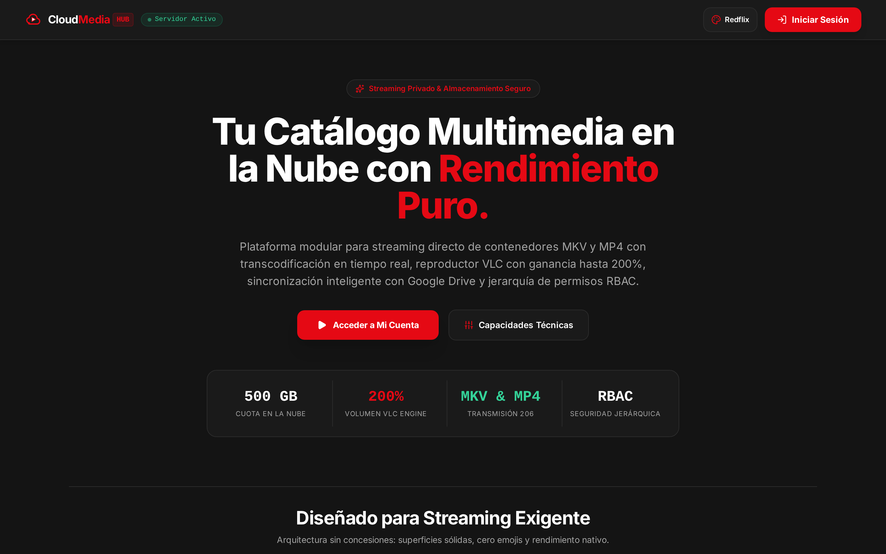

  <p align="center">
    <strong>Plataforma cinematográfica modular para streaming multimedia privado de alto rendimiento y gestión de almacenamiento en la nube integrada con rclone, Google Drive, transcodificación en tiempo real y seguridad RBAC.</strong>
  </p>

  <p align="center">
    
    
    
    
    
    
    
  </p>
</div>

---

## Índice

- [Galería del Sistema](#-galería-del-sistema)
  - [Landing Page de Bienvenida](#1-landing-page-de-bienvenida)
  - [Autenticación con Fondo Difuminado](#2-autenticación-y-cambio-obligatorio-de-clave)
  - [Catálogo Principal y Reproducción](#3-catálogo-principal-y-navegación-de-ancho-completo)
  - [Showcase de los 5 Temas Cinemáticos Puros](#4-showcase-de-los-5-temas-cinemáticos-puros)
  - [Reproductor Estilo VLC con Audio hasta 200%](#5-reproductor-estilo-vlc-con-audio-web-api-hasta-200)
  - [Explorador de Almacenamiento en la Nube](#6-explorador-de-almacenamiento-en-la-nube-rclone)
  - [Dashboard de Administración Integral](#7-dashboard-de-administración-integral)
  - [Experiencia Móvil Responsiva](#8-experiencia-móvil-responsiva)
- [Arquitectura y Capacidades Técnicas](#-arquitectura-y-capacidades-técnicas)
- [Gestión de Usuarios y Roles (RBAC)](#-gestión-de-usuarios-y-roles-rbac)
- [Estructura del Proyecto](#-estructura-del-proyecto)
- [Puesta en Marcha y Despliegue](#-puesta-en-marcha-y-despliegue)
- [Variables de Entorno (Vercel & Local)](#-variables-de-entorno)
- [Pruebas Automatizadas E2E (Playwright)](#-pruebas-automatizadas-e2e)

---

## 📸 Galería del Sistema

### 1. Landing Page de Bienvenida
Página pública inicial antes de iniciar sesión y destino automático tras el cierre de sesión, con métricas clave, capacidades técnicas y selector de temas.


---

### 2. Autenticación y Cambio Obligatorio de Clave
Flujo de acceso limpio con fondo oscurecido y difuminado (`backdrop-blur-md`), atrapado de foco accesible (`useFocusTrap`) y validación estricta de primer inicio de sesión.

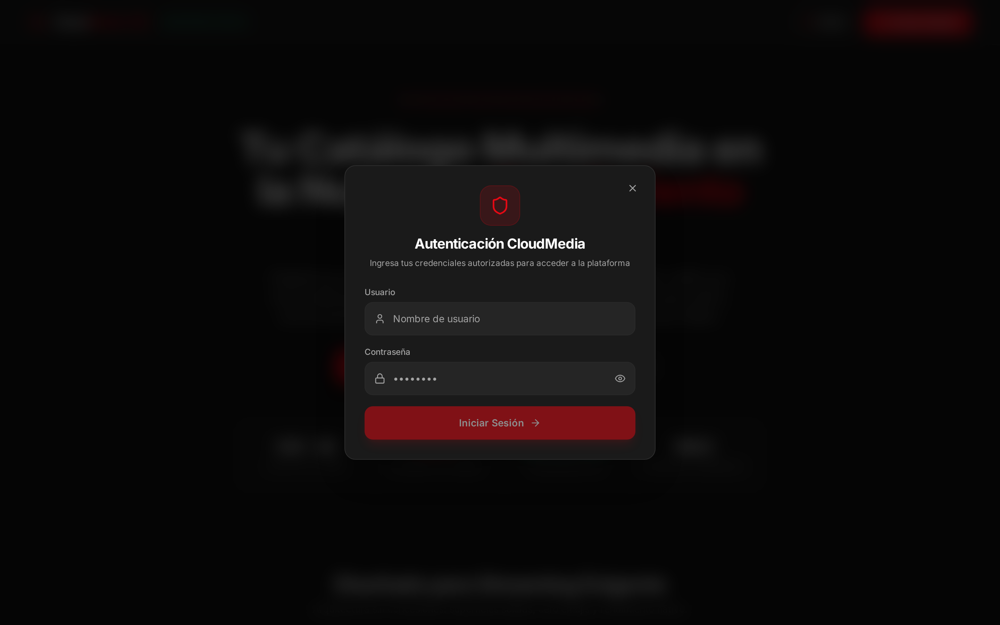

---

### 3. Catálogo Principal y Navegación de Ancho Completo
Barra de navegación de ancho completo (`w-full`) con pestañas centradas naturalmente, buscador integrado (`Ctrl+K`), métricas de cuota Google Drive y tarjetas de catálogo con ficha técnica 3D.

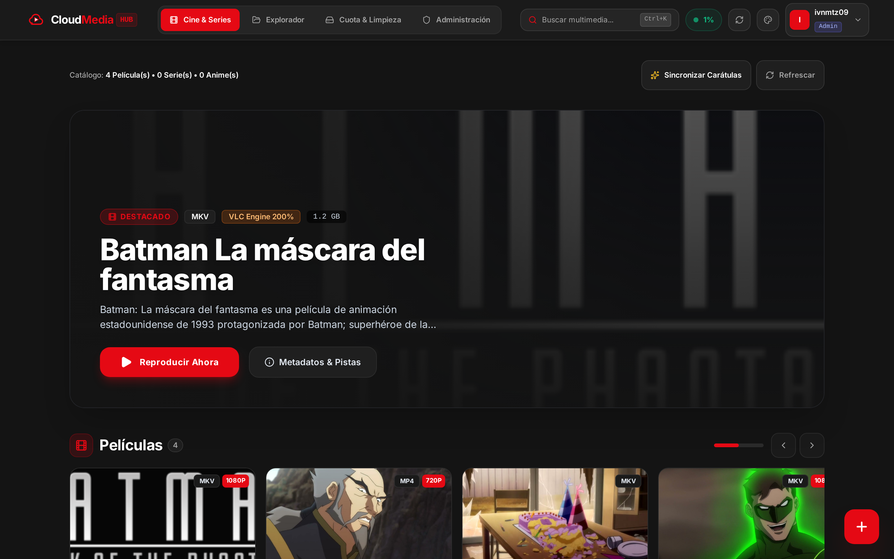

---

### 4. Showcase de los 5 Temas Cinemáticos Puros
Eliminación total de glassmorphism translúcido en favor de superficies 100% sólidas y opacas de alta definición inspiradas en plataformas de streaming líderes:

| Tema | Previsualización | Paleta y Estilo |
| :--- | :--- | :--- |
| **Redflix** *(Predeterminado)* |  | Fondo carbón `#141414`, superficies `#1a1a1a`, acento rojo cinematográfico `#E50914`. |
| **Magic Plus** | 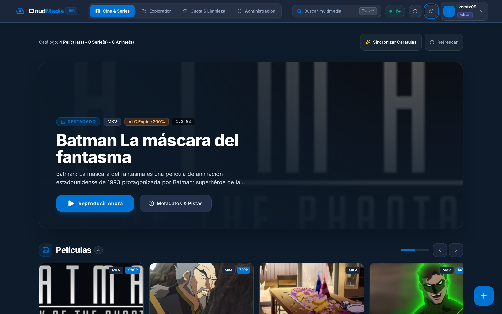 | Fondo azul medianoche `#0d1b2a`, superficies `#1b263b`, acento cian eléctrico `#0072d2`. |
| **Anime Studio** | 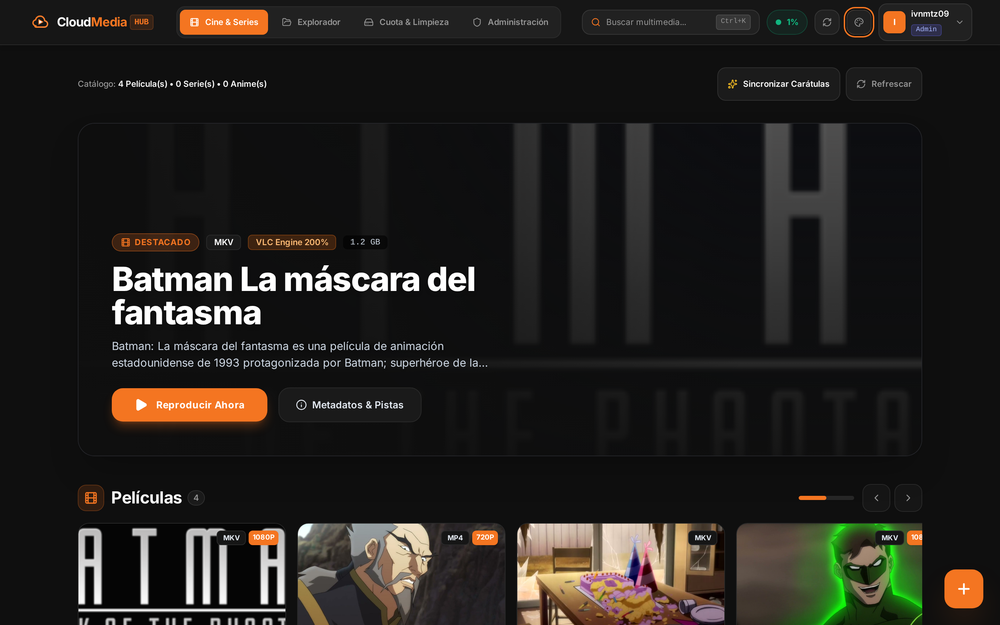 | Fondo grafito `#0f0f0f`, superficies `#1a1a1a`, acento naranja vibrante `#F47521`. |
| **Max Cinema** | 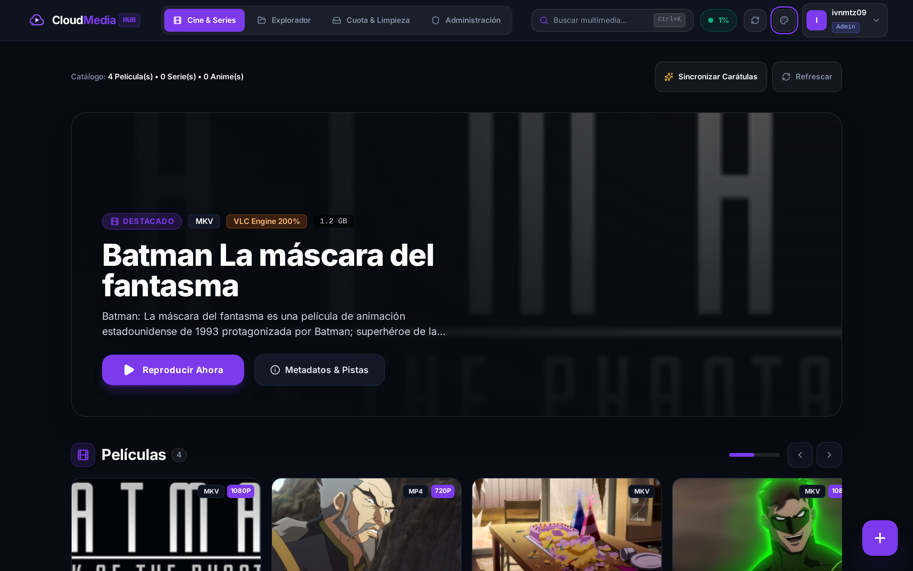 | Fondo azul noche `#080b11`, superficies `#121826`, acento púrpura neón `#7C3AED`. |
| **Prime Vision** | 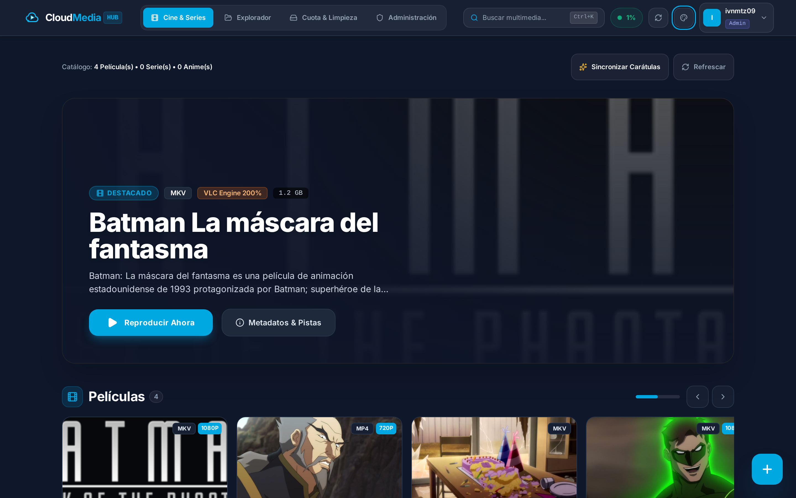 | Fondo azul carbón `#0f172a`, superficies `#1e293b`, acento cian institucional `#00a8e1`. |

#### Selector de Apariencia y Densidad de Cuadrícula
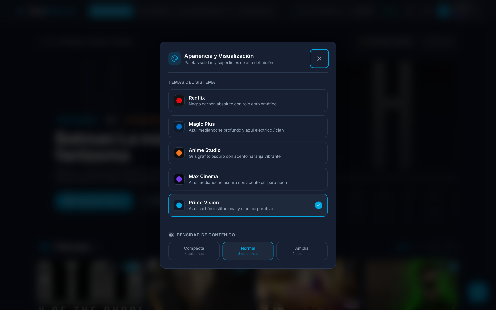

---

### 5. Reproductor Estilo VLC con Audio Web API hasta 200%
Reproductor avanzado con remuxing instantáneo para contenedores MKV y MP4, OSD contextual con iconos semánticos (`Play`, `Pause`, `Volume`, `Audio`, `Subtítulos`), selector dinámico de pistas de audio (Dual/Latino) y sobreamplificación de volumen hasta 200%.

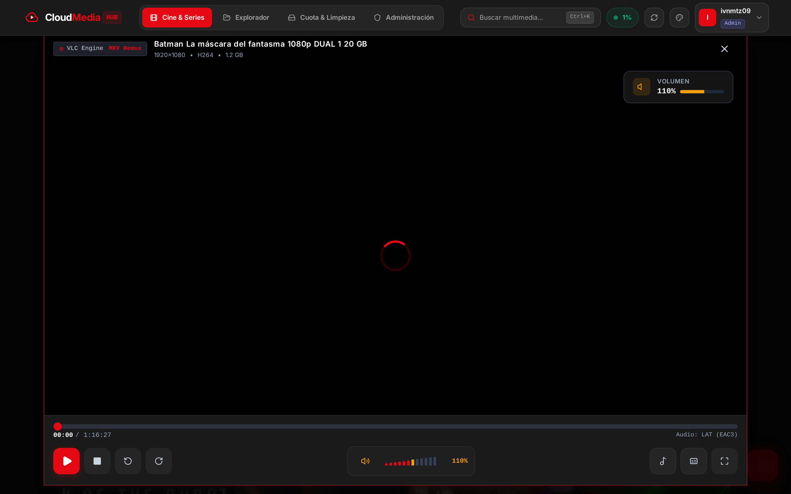

---

### 6. Explorador de Almacenamiento en la Nube (rclone)
Explorador de carpetas sincronizado con Google Drive (`PC_Storage`), salto rápido por categorías, subida de archivos pesados y reproducción directa.

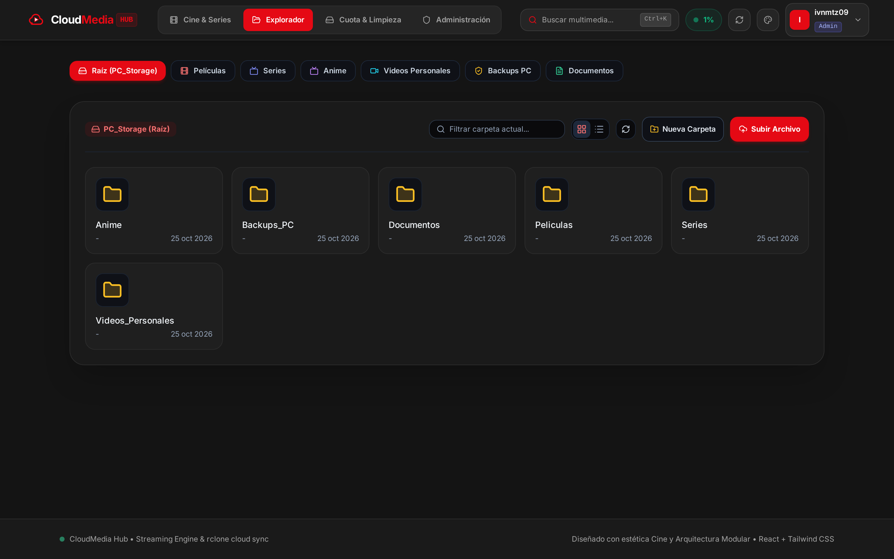

---

### 7. Dashboard de Administración Integral
Panel administrativo con barra de navegación lateral fija (`aside`), métricas en tiempo real con contadores animados, auditoría de eventos del sistema y gestión CRUD de roles y usuarios.

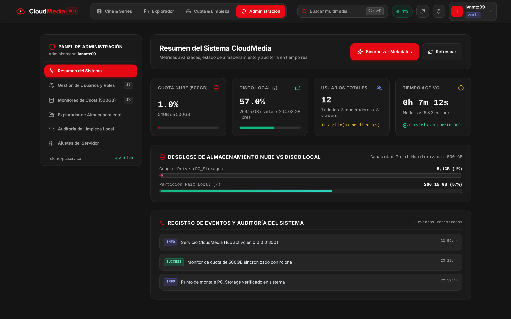

---

### 8. Experiencia Móvil Responsiva
Diseño optimizado para pantallas táctiles con barra de navegación inferior de **4 botones limpios**, buscador en la cabecera superior y panel deslizante (drawer) accesible con tarjeta de cuota y perfil.

<div align="center">
  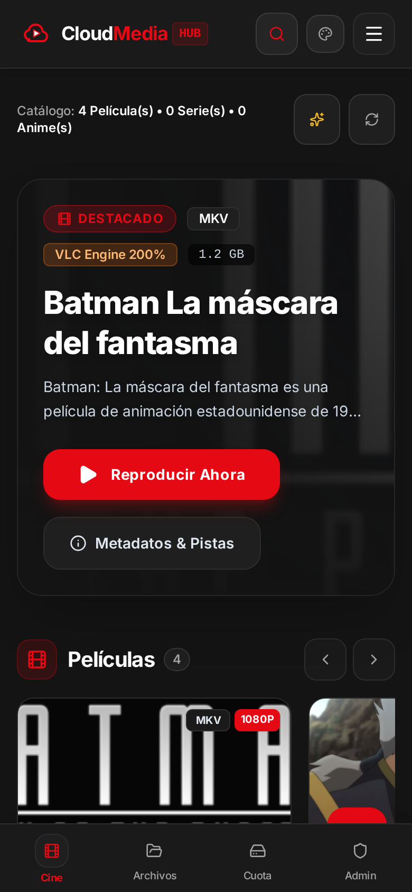
  &nbsp;&nbsp;&nbsp;&nbsp;
  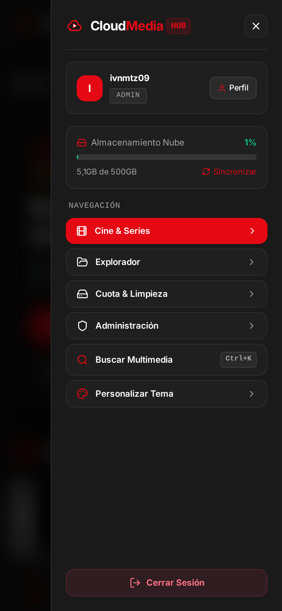
</div>

---

## ⚡ Arquitectura y Capacidades Técnicas

1. **Streaming HTTP 206 & Remuxing en Vivo:**
   - Soporte nativo de rangos parciales HTTP 206 y remuxing en tiempo real con `ffmpeg` y `ffprobe`.
   - Salto temporal instantáneo con parámetro `?start=<segundos>` posicionado antes del archivo de entrada (`-ss <seg> -i <path>`) para evitar retrasos de precarga.
2. **Motor de Audio Web API (VLC 200% GainNode):**
   - Conexión del elemento `<video>` con `AudioContext` y `GainNode` para alcanzar hasta 200% de volumen real.
   - OSD visual contextual con indicación porcentual y colores semánticos: verde (0-100%), ámbar (100-150%) y rojo (150-200%).
3. **Superficies Sólidas y Difuminado de Fondo:**
   - Cero glassmorphism translúcido en las superficies operativas: bordes nítidos y colores 100% opacos.
   - Al desplegar modales o el reproductor, el fondo se oscurece y difumina suavemente (`bg-black/75 backdrop-blur-md`).
4. **Atrapado de Foco y Accesibilidad WCAG (`useFocusTrap`):**
   - Al abrir cualquier modal, el foco del teclado (`Tab` / `Shift+Tab`) queda confinado estrictamente en el diálogo activo para evitar que el usuario interactúe involuntariamente con la página de fondo.
   - Salida rápida con tecla `Escape` y retorno de foco al elemento de origen.
5. **Scroll Restoration Inteligente:**
   - `history.scrollRestoration = 'manual'` activo en el navegador.
   - Retorno automático e instantáneo a la posición superior (`top: 0`) al cambiar de pestaña principal, navegar en subcarpetas del explorador o alternar secciones del panel de administración.
6. **Command Palette Global (`Ctrl+K`):**
   - Buscador rápido con atajo de teclado y filtros combinados de categorías (`Películas`, `Series`, `Anime`), resoluciones (`1080p`, `720p`) e idiomas de audio (`DUAL`, `LAT`).
7. **Cero Emojis:**
   - Uso riguroso de iconografía vectorial SVG mediante [Lucide React](https://lucide.dev/).

---

## 👥 Gestión de Usuarios y Roles (RBAC)

El sistema opera con control de acceso basado en roles jerárquicos:

| Usuario | Rol | Nivel | Permisos Principales |
| :--- | :--- | :---: | :--- |
| `ivnmtz09` | `admin` | **3** | Control total, métricas, gestión CRUD de usuarios, cambio de roles, ajuste del servidor y sincronización manual de cuota. |
| `baxter`, `bimo`, `juank` | `moderator` | **2** | Streaming, subida clasificada (árbol de series/temporadas) y enriquecimiento de metadatos. |
| `bozame`, `saudiki`, `manu`, `mawi`, `juliao`, `carlos`, `karlos`, `hasmid` | `viewer` | **1** | Acceso al catálogo multimedia, reproducción VLC, búsqueda y configuración de perfil. |

> [!NOTE]
> Todos los usuarios cuentan con la clave inicial `1234567890`. Al primer inicio de sesión se exige el cambio de contraseña por una personalizada de al menos 8 caracteres.

---

## 📁 Estructura del Proyecto

```
cloudmedia-hub/
├── backend/
│   ├── data/
│   │   ├── movies_metadata.json
│   │   ├── users.json
│   │   └── watch_progress.json
│   ├── src/
│   │   ├── middleware/auth.js
│   │   ├── routes/
│   │   │   ├── auth.js
│   │   │   ├── cleanup.js
│   │   │   ├── files.js
│   │   │   ├── movies.js
│   │   │   ├── stats.js
│   │   │   ├── stream.js
│   │   │   └── users.js
│   │   ├── services/
│   │   │   ├── filesService.js
│   │   │   ├── metadataService.js
│   │   │   ├── statsService.js
│   │   │   └── streamService.js
│   │   └── server.js
│   └── package.json
├── frontend/
│   ├── src/
│   │   ├── components/
│   │   │   ├── admin/
│   │   │   ├── auth/
│   │   │   ├── common/
│   │   │   ├── explorer/
│   │   │   ├── landing/
│   │   │   ├── monitoring/
│   │   │   ├── profile/
│   │   │   ├── search/
│   │   │   ├── streaming/
│   │   │   └── upload/
│   │   ├── contexts/
│   │   │   ├── AuthContext.jsx
│   │   │   └── ThemeContext.jsx
│   │   ├── hooks/
│   │   │   └── useFocusTrap.js
│   │   ├── styles/
│   │   │   ├── animations.css
│   │   │   └── themes.js
│   │   └── services/api.js
│   ├── tailwind.config.js
│   └── package.json
├── docs/
│   └── screenshots/
├── tests/
│   └── e2e.spec.js
├── playwright.config.js
└── README.md
```

---

## 🚀 Puesta en Marcha y Despliegue

### Prerrequisitos
- **Node.js:** Versión 18 o superior.
- **FFmpeg & FFprobe:** Instalados en el sistema operativo.
- **Rclone:** Servicio `rclone-pc.service` montado en `/home/ivnmtz09/GoogleDrive/PC_Storage`.

### Despliegue Local / Servidor
```bash
# 1. Compilar el cliente frontend
cd frontend
npm run build

# 2. Reiniciar el servicio backend en segundo plano
systemctl --user restart cloudmedia-hub-backend.service

# 3. Verificar estado del servicio
systemctl --user status cloudmedia-hub-backend.service
```

### URLs de Acceso
* **Servidor Local:** `http://localhost:3001`
* **Red Local (LAN):** `http://192.168.1.66:3001`
* **Entorno de Desarrollo (Vite):** `http://localhost:5173`

---

## ⚙️ Variables de Entorno

### Frontend (.env)
```env
VITE_API_URL=http://localhost:3001
```

### Backend (.env)
```env
PORT=3001
HOST=0.0.0.0
STORAGE_BASE_DIR=/home/ivnmtz09/GoogleDrive/PC_Storage
JWT_SECRET=tu_clave_secreta_segura
```

---

## 🧪 Pruebas Automatizadas E2E

La suite de pruebas automatizadas con Playwright cubre 10 pruebas integrales de extremo a extremo:

```bash
# Ejecutar toda la suite de pruebas
npm test
```

### Casos de Prueba Verificados:
1. **Autenticación Limpia:** Carga de modal sin presets, con alternador de visibilidad (`Eye`/`EyeOff`).
2. **Cambio Forzado de Clave:** Intercepción en primer inicio de sesión y actualización obligatoria.
3. **Admin Dashboard:** Navegación lateral fija (`aside`) con 6 secciones operativas y métricas de cuota.
4. **Perfil de Usuario:** Actualización de usuario, cambio voluntario de clave y estadísticas de visualización.
5. **Command Palette (`Ctrl+K`):** Atajo de teclado, búsqueda difusa y filtros multidimensionales.
6. **Selector de Temas:** Cambio fluido entre los 5 temas cinemáticos puros sin nombres de marcas externas.
7. **Reproductor VLC 200%:** Ganancia con Web Audio API, barra triangular y duración exacta en MKV.
8. **Ficha Técnica 3D:** Animación de giro para consulta de metadatos de medios.
9. **Cierre de Sesión:** Retorno suave a la Landing Page con Toast de confirmación de salida.
10. **Responsividad Móvil y Scroll Restoration:** Barra de navegación inferior de 4 botones, búsqueda superior, drawer deslizante y restauración de posición de scroll en cero.
